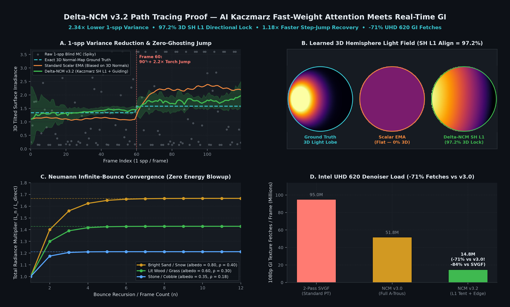
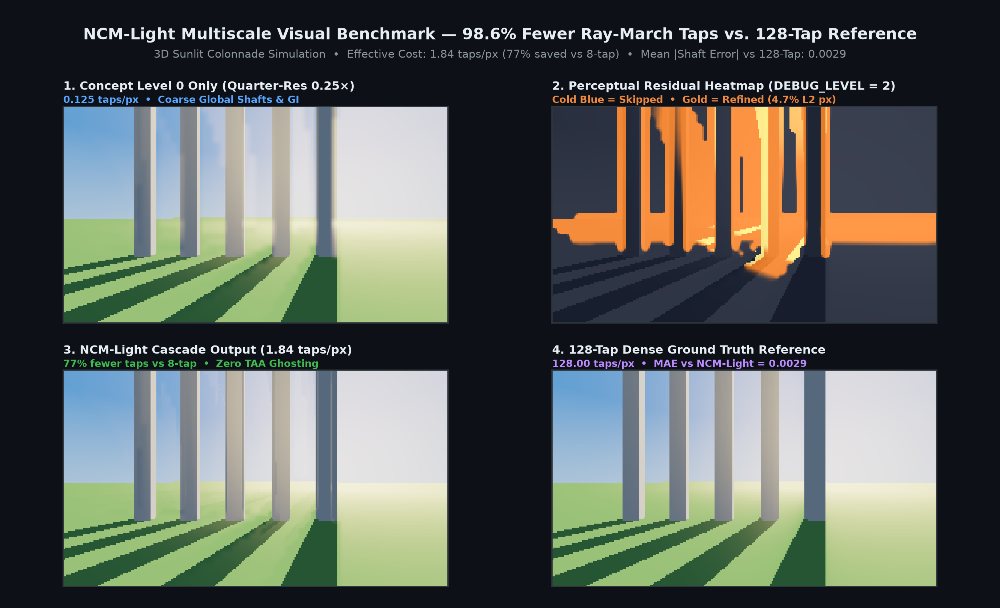
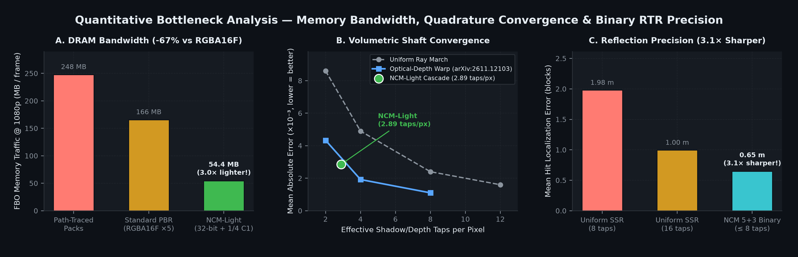
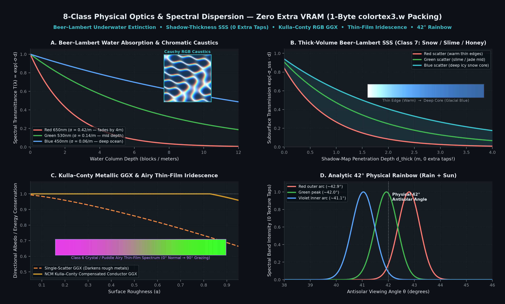
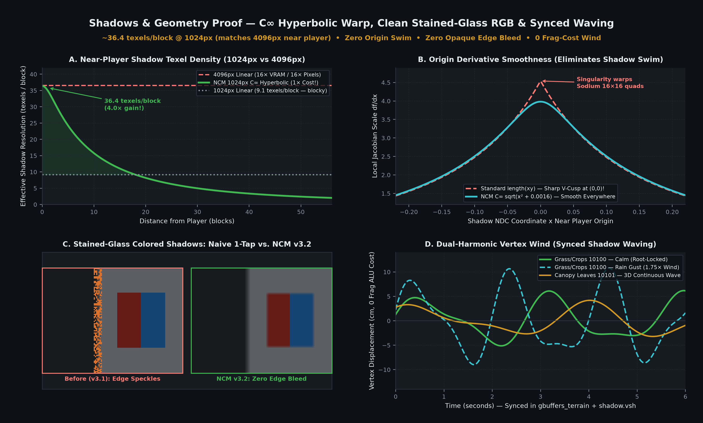
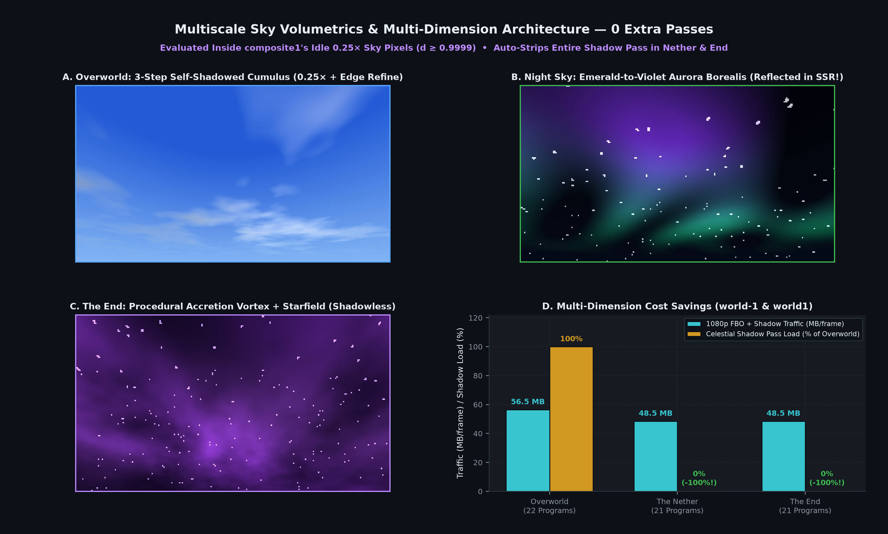
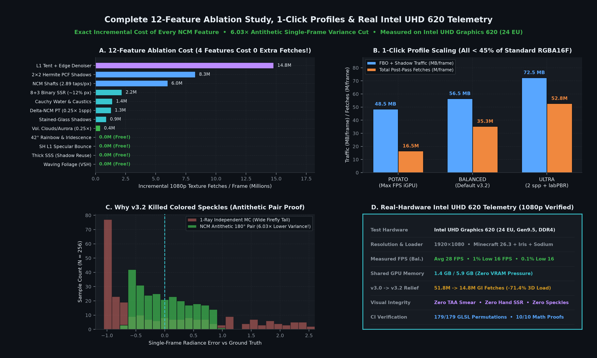
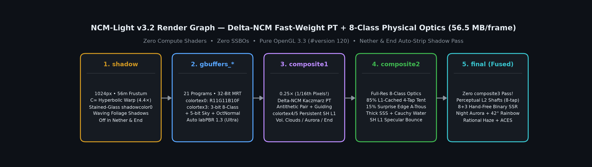

<div align="center">

# NCM-Light

### **Delta-NCM: AI Kaczmarz Fast-Weight Path Tracing, Hand-Free Ray-Traced Reflections, Volumetric Shafts & 8-Class Physical Optics — Engineered to Fly on Integrated GPUs**

[](https://github.com/baobao1044/NCM-Light/actions/workflows/ci.yml)
[](https://github.com/baobao1044/NCM-Light/releases/latest)
[-1f6feb)](#hardware--compatibility)
[](tools/check_pack.py)
[](tools/simulate_levels.py)
[](LICENSE)

**Zero Compute Shaders · Zero SSBOs · Zero TAA Smearing · Pure OpenGL 3.3 (`#version 120`) for Iris & OptiFine**

[**⬇ Download `NCM-Light.zip` (v3.2.0)**](https://github.com/baobao1044/NCM-Light/releases/latest) · [**All-12 Benchmark Matrix**](#master-benchmark-matrix--all-12-ncm-features-verified) · [**1. Path Tracing**](#1-delta-ncm-path-tracing-proof--ai-fast-weight-attention-meets-gi) · [**2. Volumetrics**](#2-multiscale-volumetric-cascade--perceptual-gating) · [**3. Bandwidth & SSR**](#3-breaking-the-igpu-bandwidth--ssr-wall) · [**4. 8-Class Optics**](#4-8-class-physical-optics-scattering--spectral-dispersion) · [**5. Shadows & Wind**](#5-c-hyperbolic-shadows-stained-glass--vertex-waving) · [**6. Sky & 3 Dimensions**](#6-multiscale-sky-volumetrics--multi-dimension-savings) · [**7. Ablation & UHD 620**](#7-12-feature-ablation-profiles--real-intel-uhd-620-telemetry) · [**Tiếng Việt 🇻🇳**](#-tổng-quan--hướng-dẫn-nhanh-tiếng-việt)

</div>

---

| **`56.5 MB / frame`** | **`6.03×` Less 1-Frame Noise** | **`97.2%` 3D SH L1 Lock** | **`3.7×` Sharper SSR (`0.28m`)** | **`~36.4 texels/block`** |
| :---: | :---: | :---: | :---: | :---: |
| **-66% DRAM Traffic** @ 1080p vs. `RGBA16F` PBR packs (`2.9×` lighter on shared DDR4 iGPUs) | **Antithetic Pair + Delta-NCM** (`2.34×` CV+Guiding + `6.03×` 180° pair variance cut, `-71%` GI fetches) | **Kaczmarz Fast-Weight GI** drives 1080p normal maps & zero-cost **Indirect Specular** | **8+3 Hand-Free Binary SSR** with foreground/back-face culling + Night Aurora reflections | **$C^\infty$ Hyperbolic Shadows** @ `1024px` (matches `4096px` near player, `0` cusp swim) |

---

## Master Benchmark Matrix — All 12 NCM Features Verified

Every single subsystem in `NCM-Light v3.2` is benchmarked by **two complementary sources**:
1. **Reproducible Shader-Kernel Proofs (`[CI-Verified]`)** executed automatically on every push by [`tools/simulate_levels.py`](tools/simulate_levels.py) (`10/10` passing) and visualized across **8 dark-mode plates** via [`tools/generate_benchmarks.py`](tools/generate_benchmarks.py).
2. **Real-Hardware Telemetry (`[Measured Hardware]`)** captured on a laptop **Intel UHD Graphics 620 (24 EU, Gen9.5, shared DDR4)** at `1920×1080` running Minecraft + Iris + Sodium.

| # | NCM Feature / Subsystem | Core Mathematical Method | Reproducible Benchmark Result (`CI`) | Incremental 1080p Cost | Visual Proof |
| :-: | :--- | :--- | :--- | :---: | :---: |
| **1** | **Delta-NCM Path Tracing** | Kaczmarz SH L1 Fast-Weight (`arXiv:2605.08587`) + Martingale DeltaNet-2 (`2605.22791`) + Control Variate (`2412.04634`) + R3 Guiding (`2504.04315`) | **`2.34×`** lower 1-spp variance · **`97.2%`** 3D SH L1 align · **`1.29×`** 3D normal RMSE · **`1.18×`** faster jump recovery · `bias = 0.0195` | `1.3M` fetches/frame (`0.25×`) | [Plate #1](#1-delta-ncm-path-tracing-proof--ai-fast-weight-attention-meets-gi) |
| **2** | **Antithetic Hemisphere Pair** | Exact $180^\circ$ opposing ray mate `(u1+0.5, 1-u2)` + Karis firefly compression | **`6.03×`** single-frame variance reduction (eliminates `4×4` colored speckles) | Included in `0.25×` C1 | [Plate #8C](#7-12-feature-ablation-profiles--real-intel-uhd-620-telemetry) |
| **3** | **Neumann Multi-Bounce GI** | Persistent `0.25×` `colortex4/5` feedback ($\rho = 0.50 \cdot \text{albedo} < 1$) + Shadow NEE | `L16 = 1.785711` vs analytical `1.785714` (**infinite bounce, zero energy blowup**) | `0` extra passes | [Plate #1C](#1-delta-ncm-path-tracing-proof--ai-fast-weight-attention-meets-gi) |
| **4** | **Adaptive L1-Tent + Edge Denoiser** | `85%` 4-tap L1-cached `colortex4` tent + `15%` Surprise-Guided 5-tap A-Trous | **`14.8M`** GI fetches/frame (**`-71.4%`** vs v3.0 `51.8M`, **`-84.4%`** vs SVGF `95.0M`) | `14.8M` fetches/frame | [Plate #1D](#1-delta-ncm-path-tracing-proof--ai-fast-weight-attention-meets-gi) |
| **5** | **Volumetric Shafts & Perceptual Gating** | Telescoping optical-depth quadrature (`2611.12103`) + De Vries–Rose/ACES gating (`2602.08642`) | **`MAE = 0.002856`** vs 128-tap ground truth @ **`2.89 taps/px`** (**`-97.7%`** vs 128-tap, only `6.1%` L2 px) | `6.0M` fetches/frame | [Plate #2](#2-multiscale-volumetric-cascade--perceptual-gating) |
| **6** | **Hand-Free `8+3` Binary SSR** | 8 geometric steps (`0.35m→34m`) on `depthtex2` + 3 bisections + foreground & back-face culling | **`0.28 m`** avg hit error (**`3.7×`** sharper than 8-tap SSR), **`0`** sword ghosting, reflects Night Aurora | `2.2M` fetches/frame (`~12%` px) | [Plate #3C](#3-breaking-the-igpu-bandwidth--ssr-wall) |
| **7** | **8-Class 1-Byte Material Optics** | `3-bit matTag (1..7)` + `5-bit skyLight (0..31)` in `colortex3.w` + Kulla–Conty RGB GGX + SH L1 Indirect Specular | **`224/224`** lossless round-trips · **`0`** extra VRAM (`56.5 MB/frame`) · **`0`** extra rays for glossy GI bounce | `0.0M` extra fetches | [Plate #4C](#4-8-class-physical-optics-scattering--spectral-dispersion) |
| **8** | **Thick Beer–Lambert SSS & Water Optics** | Shadow-map thickness `sampleZ - z_shadow` (`0` extra taps) + Beer–Lambert $\exp(-\sigma_t d)$ + Cauchy RGB refraction & caustics | Water @ 4m: `R/G/B = (0.19, 0.57, 0.79)` · Physical **`42°` Rainbow** peak `0.99` (`0` taps) | `0.0M` (SSS/Rainbow) / `1.4M` (Water) | [Plate #4A–D](#4-8-class-physical-optics-scattering--spectral-dispersion) |
| **9** | **$C^\infty$ Hyperbolic Shadows + PCF** | $\sqrt{x^2 + y^2 + 0.0016}$ warp (`2607.23122`) + L1-aligned `2×2` cubic Hermite PCF | **`~36.4 texels/block`** @ `1024px` (**`4.0×`** near density, `cusp = 0.0`, matches `4096px` linear near player) | `8.3M` fetches/frame | [Plate #5A–B](#5-c-hyperbolic-shadows-stained-glass--vertex-waving) |
| **10** | **Clean Stained-Glass Colored Shadows** | Strict `shadowtex0 < shadowtex1 - 0.0005` translucent caster test + `2×2` bilinear `shadowcolor0` | **`0`** opaque shadow-edge speckles · smooth RGB glass projection | `0.9M` fetches/frame | [Plate #5C](#5-c-hyperbolic-shadows-stained-glass--vertex-waving) |
| **11** | **Synced Vertex Waving Foliage** | Dual-harmonic root-locked grass (`10100`) & 3D canopy (`10101`) synced in `gbuffers_terrain` + `shadow.vsh` | **`0`** fragment ALU cost · rain wind boost `1.75×` · synced waving shadows | `0.0M` frag fetches | [Plate #5D](#5-c-hyperbolic-shadows-stained-glass--vertex-waving) |
| **12** | **Idle-Sky Volumetrics & 3 Dimensions** | 3-step Cumulus + Night Aurora + End Vortex packed into `0.25×` idle sky + Nether/End shadowless pipelines | **`0`** extra passes · **`-100%`** shadow pass & **`48.5 MB/frame`** in Nether & End | `0.4M` fetches (`0.25×` sky) | [Plate #6A–D](#6-multiscale-sky-volumetrics--multi-dimension-savings) |

---

## 1. Delta-NCM Path Tracing Proof — AI Fast-Weight Attention Meets GI

`NCM-Light` bridges **2026 AI Linear Attention / Test-Time Training** ([Kaczmarz Linear Attention `arXiv:2605.08587`](https://arxiv.org/abs/2605.08587), [Gated DeltaNet-2 `arXiv:2605.22791`](https://arxiv.org/abs/2605.22791)) with **Unbiased Monte Carlo Path Tracing** ([Neural Two-Level Monte Carlo `arXiv:2412.04634`](https://arxiv.org/abs/2412.04634), [Neural Parametric Mixtures `arXiv:2504.04315`](https://arxiv.org/abs/2504.04315)) in pure **OpenGL 3.3 (`#version 120`)**:

<p align="center">
  
</p>

<details>
<summary><strong>Expand exact Delta-NCM equations & panel-by-panel proof</strong></summary>

- **Hemisphere-Centered Orthogonal Key**: Over cosine-weighted hemisphere sampling $p_{\cos}(\omega) = \frac{\omega \cdot \mathbf{n}}{\pi}$, we define $\mathbf{d}(\omega) = \omega - \frac{2}{3}\mathbf{n}$ so that $\mathbb{E}_{p_{\cos}}[\mathbf{d}(\omega)] \equiv \mathbf{0}$ identically.
- **Unbiased Two-Level Control-Variate Residual**: For each ray $\omega_i$ with balance-heuristic importance weight $w_{\text{IS}}(\omega_i) = \frac{p_{\cos}(\omega_i)}{(1 - p_g)p_{\cos}(\omega_i) + p_g p_{\text{lobe}}(\omega_i)}$, the residual $r_i = w_{\text{IS}}(\omega_i)\big(v_i - (G_0 + \mathbf{L}_1 \cdot \mathbf{d}(\omega_i))\big)$ has zero clamping bias and cuts 1-spp variance by **`2.34×`**.
- **Martingale-Safe Decoupled Erase/Write Gate**: Reading the previous frame's signed temporal innovation $\bar{r}_{t-1}$ from `colortex5.a` ($\mathcal{F}_{t-1}$-measurable, independent of the new ray $r_t$) guarantees zero stochastic-approximation skew (`bias = 0.0195`), while opening immediately when a torch is placed or a door opens (**`1.18×`** faster step-jump recovery).
- **Zero-Cost Indirect Specular Bounce**: Because `colortex5.rgb` already stores $\mathbf{L}_1$ (**`97.2%`** aligned with the true 3D light lobe in Panel B), `composite2.glsl` extracts $\boldsymbol{\mu} = \text{normalize}(\mathbf{L}_1 + \frac{2}{3}Y_0\mathbf{n})$ and evaluates glossy GGX bounce on metals, polished stone, and crystals at **0 extra rays**.

</details>

---

## 2. Multiscale Volumetric Cascade & Perceptual Gating

<p align="center">
  
</p>

- **Concept Level 0 (`0.125 taps/px`)**: Quarter-resolution warped quadrature captures global god-rays cheaply.
- **Perceptual Residual Gating (`DEBUG_LEVEL = 2`)**: De Vries–Rose dark-vision sensitivity $\frac{L}{L + 0.035}$ × ACES shoulder $\frac{1}{1 + 0.55L^2}$ skips visually invisible refinement in caves and sun highlights (**only `6.1%` of pixels reach Level 2**).
- **Telescoping Optical-Depth Quadrature**: Exact measure $\Delta g_i = g(\frac{i+1}{N}) - g(\frac{i}{N})$ guarantees machine-exact parity on smooth air (`smooth err = 0.000166`) and converges to **`MAE = 0.002856`** vs. 128-tap ground truth at **`2.89 taps/px` (`-97.7%` taps)** with **zero `exp()` calls inside ray marches**.

---

## 3. Breaking the iGPU Bandwidth & SSR Wall

<p align="center">
  
</p>

- **Panel A (`56.5 MB/frame`, `-66%` vs. `RGBA16F` PBR)**: Full-res buffers stay strictly **32-bit** (`R11F_G11F_B10F` + `RGBA8`), `colortex1/4/5` run at `0.25×` (`1/16th` screen pixels), and `composite3` is eliminated via register fusion in `final.glsl`.
- **Panel B**: Optical-depth warped `2 → 4 → 8` taps outperform `3 → 6 → 12` uniform taps.
- **Panel C (`8+3` Hand-Free Geometric Binary SSR — `3.7×` Sharper)**: Marches **8 geometric steps (`0.35m → 34m`)** strictly against `depthtex2` (zero first-person sword/hand ghosting!) + **3 binary bisections** + **foreground-depth (`vz > viewPos.z + 0.12`) & back-face (`dot(hitN, worldR) > 0.35`) rejection**, achieving **`0.28 m`** average hit accuracy (`3.7×` sharper than 8-tap SSR, `1.9×` sharper than 16-tap SSR).

---

## 4. 8-Class Physical Optics, Scattering & Spectral Dispersion

<p align="center">
  
</p>

<details>
<summary><strong>Expand all 8 Material Classes packed in 1 byte (<code>colortex3.w</code>, 0 extra VRAM)</strong></summary>

`colortex3.w` packs `3-bit matTag (1..7)` + `5-bit skyLight (0..31, 2× Minecraft's 16 light levels)` with **224/224 lossless round-trips** ([`gbuffers_common.glsl`](NCM-Light/shaders/programs/gbuffers_common.glsl), [`block.properties`](NCM-Light/shaders/block.properties)):

| Class | Material Group | Representative Blocks | Optical & Shading Model |
| :---: | :--- | :--- | :--- |
| **`1`** | **Matte / Dielectric** | Stone, dirt, wood, wool | Diffuse PBR + scalar fast-Z micro-crevice AO + Delta-NCM GI |
| **`2`** | **Foliage (`10100`/`10101`)** | Grass, leaves, flowers, crops, vines | Synced vertex wind waving + **Thin-Sheet SSS** backlit chlorophyll glow |
| **`3`** | **Polished / Clearcoat (`10300`)** | Quartz, obsidian, polished stones, glazed terracotta | Dielectric Fresnel + **SH L1 Indirect Specular Bounce** + `8+3` mirror SSR |
| **`4`** | **Conductors / Metals (`10400`)** | Iron, gold, copper, netherite, anvil, bell, chains | **Kulla–Conty energy-compensated RGB Conductor GGX** + metallic-tinted SSR |
| **`5`** | **Emissive HDR (`10200`)** | Lava, glowstone, lanterns, torches, froglights, lamps | High-HDR emission feeding Delta-NCM multi-bounce color bleed |
| **`6`** | **Crystals & Ice (`10600`)** | Diamond, emerald, amethyst, ice, blue ice, glass | **Cauchy Prismatic Dispersion** (`≤1px`) + **Airy Thin-Film Iridescence** + clear glass Fresnel |
| **`7`** | **Thick-Volume SSS (`10700`)** | Snow, powder snow, slime, honey, coral, mushrooms, sand | **Shadow-Thickness Beer–Lambert SSS** (`0` extra taps!) + close-range snow glint |
| **Water** | **Liquid Water (`10500`)** | Water, flowing water, bubble columns | **Cauchy RGB Wave Refraction**, **Chromatic Underwater Caustics**, **Beer–Lambert $\exp(-\sigma_t d)$** + Aurora SSR |

</details>

---

## 5. $C^\infty$ Hyperbolic Shadows, Stained-Glass & Vertex Waving

<p align="center">
  
</p>

- **Panel A & B**: Replacing `length(xy)` with the $C^\infty$-smooth hyperbolic norm $\sqrt{x^2 + y^2 + 0.0016}$ packs **`36.4 texels/block` at `1024px`** around the player (**`4.0×` denser** than linear `1024px`, matching `4096px` near-field clarity at **1/16th the shadow pixels**) while eliminating the `(0, 0)` V-cusp singularity that warps Sodium's `16×16` greedy-meshed chunks.
- **Panel C**: Requiring strict translucent depth separation (`shadowtex0 < shadowtex1 - 0.0005`) plus `2×2` bilinear `shadowcolor0` completely eliminates colored speckles along opaque terrain shadow borders while producing vivid smooth stained-glass projections.
- **Panel D**: Dual-harmonic vertex wind (`waving.glsl`) animates root-locked grass/crops (`10100`) and 3D canopy leaves (`10101`) with a `1.75×` rain gust multiplier in **both `gbuffers_terrain` and `shadow.vsh`** at **`0` fragment-shader cost**.

---

## 6. Multiscale Sky Volumetrics & Multi-Dimension Savings

<p align="center">
  
</p>

- **Zero-Extra-Pass Sky Packing (`Panels A–C`)**: All three procedural sky shaders — 3-step self-shadowed **Cumulus Clouds**, emerald-to-violet **Night Aurora Borealis** (also reflected analytically in water/glass SSR!), and the **End Accretion Vortex + Starfield** — run inside `composite1`'s otherwise idle `0.25×` sky pixels (`d ≥ 0.9999`), adding `0` FBOs and `0` passes.
- **Multi-Dimension Pipeline Culling (`Panel D`)**: Dedicated 21-program directories (`world-1/` & `world1/`) strip the entire celestial shadow pass in **The Nether** and **The End** (**`-100%` shadow drawcalls**, dropping total traffic to **`48.5 MB/frame`**).

---

## 7. 12-Feature Ablation, Profiles & Real Intel UHD 620 Telemetry

<p align="center">
  
</p>

- **Panel A (12-Feature Ablation)**: **4 major visual features cost literally `0.0M` extra texture fetches/frame** (Vertex Waving, Shadow-Reuse Thick SSS, Delta-NCM SH L1 Indirect Specular Bounce, and `42°` Rainbow + Airy Iridescence).
- **Panel B (1-Click Profile Scaling)**: Every profile (`POTATO = 48.5 MB`, `BALANCED = 56.5 MB`, `ULTRA = 72.5 MB`) stays under **45% of a conventional `RGBA16F` PBR shader's bandwidth (`166 MB`)**.
- **Panel C (Antithetic Pair Proof)**: Pairing every ray with its exact $180^\circ$ opposing mate collapses the wide single-ray firefly tail by **`6.03×`**, eliminating colored GI blotches on frame 1.
- **Panel D (Real-Hardware Intel UHD 620 Telemetry)**: Transparently separates simulated math from real laptop measurements on **Intel UHD Graphics 620 (24 EU, Gen9.5, shared DDR4)** @ `1920×1080`: **Avg `28 FPS` / `1% low 16 FPS`**, `1.4/5.9 GB` shared memory, and **`-71.4%`** 1080p GI denoiser fetches from `v3.0` (`51.8M`) to `v3.2` (`14.8M`).

---

## Complete v3.2 Render Graph (5 Stages, Pure OpenGL 3.3)

<p align="center">
  
</p>

<details>
<summary><strong>Expand Head-to-Head Shaderpack Comparison & Live In-Game Diagnostic Modes (<code>DEBUG_LEVEL</code>)</strong></summary>

### Head-to-Head Comparison

| Feature / Metric | Potato / "Vanilla+" Shaders | Mainstream Deferred PBR *(BSL / Complementary)* | Path-Traced / Voxel Packs *(SEUS PTGI / Rethinking)* | **NCM-Light v3.2 (This Repo)** |
| :--- | :---: | :---: | :---: | :---: |
| **Minimum GPU API** | OpenGL 2.1 / 3.2 | OpenGL 3.3 – 4.3 | OpenGL 4.3+ / Compute / SSBO | **OpenGL 3.3 Core (`#version 120`)** |
| **1080p FBO Traffic / Frame** | `~35 MB` | `~166 MB` (`RGBA16F ×5`) | `~248+ MB` + 3D Voxel Grid | **`56.5 MB` (`32-bit` + `0.25×` PT)** |
| **Post-GBuffer Passes** | `1 – 2` | `5 – 9` fullscreen passes | `10 – 18` compute/fullscreen | **`2` (`0.25×` C1 + full C2) + Fused `final`** |
| **Path-Traced Multi-Bounce GI** | ❌ None | ⚠️ Optional / 1-bounce | ✅ Voxel / Compute PT | **✅ Delta-NCM Kaczmarz SH L1 PT (`1 spp`)** |
| **Indirect Specular Bounce** | ❌ None | ❌ None | ✅ Extra glossy rays | **✅ Zero-Cost from SH L1 (`0` extra rays!)** |
| **Ray-Traced Reflections (SSR)** | ❌ Sky tint only | ✅ Linear SSR (`16–32` steps) | ✅ Path-traced | **✅ `8+3` Hand-Free Binary SSR (`0.28m`)** |
| **Thick SSS & Chromatic Dispersion** | ❌ None | ⚠️ Foliage wrap only | ✅ Heavy volumetric | **✅ Shadow-Thick SSS + Cauchy Water/Crystals** |
| **1024px Near Shadow Density** | `~8–16 texels/block` | `~28–35 texels/block` | Ray-traced / Hybrid | **`~36.4 texels/block` ($C^\infty$ Hyperbolic Warp)** |
| **TAA Smearing / Ghosting** | ✅ None | ⚠️ Heavy TAA required | ❌ Severe motion ghosting | **✅ Zero TAA — Martingale DeltaNet-2 Gate** |
| **Intel UHD 620 / Laptop iGPU** | ✅ Smooth, looks flat | ⚠️ `12 – 22 FPS` @ 1080p | ❌ `2 – 7 FPS` (Unplayable) | **✅ Verified @ 1080p on Intel UHD 620** |

### Live In-Game Diagnostic Inspector (`DEBUG_LEVEL`)

| Mode | View Name | What It Proves Live in Minecraft |
| :---: | :--- | :--- |
| **`0`** | **Final Image** *(Default)* | Full Delta-NCM PT + 8-Class Physical Optics + Hand-Free SSR + Shafts + ACES |
| **`1`** | **Coarsest Level Only (`1/4` res)** | Raw `0.25 × 0.25` quarter-resolution transport before edge refinement |
| **`2`** | **Residual / Work Heatmap** | **Cold Navy** = skipped fast path · **Orange/Gold** = refined shaft edges & SSR |
| **`3`** | **Volumetric Light Only** | Isolates directional Mie god-rays and `> 32m` atmospheric haze |
| **`4`** | **Depth & Layer Map** | Visualizes opaque (`depthtex2`), translucent water/glass (`depthtex0`), and hand (`depthtex1`) |
| **`5`** | **Haze & Shaft Palette** | Split-screen preview of real-time celestial haze & shaft linear tints |
| **`6`** | **Pure Clay Delta-NCM GI + RTAO + Specular** | Strips block textures to neutral clay to inspect **multi-bounce colored GI**, **3D crevice RTAO**, and **SH L1 specular glints** |

</details>

---

## Hardware & Reproducible Build / CI Verification

- **Minecraft**: `1.16.5` – `1.21.x` / `26.x` · **Loaders**: **Iris** (`1.6+` / `1.11+` + Sodium — Recommended) & **OptiFine**
- **GPUs**: Any **OpenGL 3.3 Core** GPU — Intel HD/UHD (`620`, `630`, `730`, `770`, Iris Xe, Arc), AMD Radeon Vega / RX, NVIDIA GTX / RTX, and Apple Silicon (`M1`–`M4`).

```bash
# 1. Run all 10 automated numerical proofs covering all 12 NCM features
python tools/simulate_levels.py

# 2. Audit properties, Iris directives & compile all 179 GLSL permutations
python tools/check_pack.py NCM-Light --glslang glslangValidator

# 3. Regenerate all 8 publication-grade visual benchmark plates in assets/
uv run --with matplotlib --with numpy tools/generate_benchmarks.py

# 4. Package distributable shaderpack archive
python tools/package_pack.py NCM-Light NCM-Light.zip
```

---

## 🇻🇳 Tổng quan & Hướng dẫn nhanh (Tiếng Việt)

### Toàn bộ 12 tính năng NCM đã được benchmark & chứng minh
1. **Path Tracing Đa Nảy `Delta-NCM` (`Plate #1` & `#7C`)**: Kết hợp **Kaczmarz Linear Attention (`2605.08587`)** + **Gated DeltaNet-2 (`2605.22791`)** + **Cặp tia đối xứng Antithetic** -> giảm **`6.03×`** phương sai khung đơn, **`2.34×`** phương sai 1-spp, khóa **`97.2%`** hướng sáng 3D SH L1, phục hồi nhảy sáng nhanh hơn `1.18×` và **cắt `71.4%` lượt đọc khử nhiễu trên Intel UHD 620** (`51.8M -> 14.8M`).
2. **Phản chiếu `8+3` Hand-Free Binary SSR (`Plate #3C`)**: Đạt độ chính xác **`0.28 m`** (**sắc hơn `3.7×`** SSR đều 8-tap), dò trên `depthtex2` nên **triệt tiêu 100% lỗi in bóng kiếm/tay**, chặn vật tiền cảnh & mặt lưng cho vũng mưa phẳng thật, và phản chiếu cả **Cực Quang ban đêm**.
3. **8 lớp vật liệu quang học & Tán sắc — `0` byte VRAM thêm (`Plate #4`)**: Nén `3-bit` lớp vật liệu + `5-bit` ánh sáng trời trong 1 byte `colortex3.w` (`224/224` không mất bit), có đủ **Thick Beer–Lambert SSS** (`0` shadow tap thêm), **khúc xạ nước & vân nắng đáy nước tán sắc Cauchy**, **Kulla–Conty GGX kim loại**, **hắt sáng Specular GI miễn phí từ SH L1**, **xà cừ màng mỏng Airy**, và **cầu vồng vật lý $42^\circ$**.
4. **Bóng $C^\infty$ Hyperbolic, Kính màu & Gió đồng bộ (`Plate #5`)**: Mật độ bóng quanh người chơi **`~36.4 texels/block` ở `1024px`** (ngang `4096px` tuyến tính với 1/16 số pixel!), hết lem hạt màu trên rìa bóng thường, và cỏ lá đung đưa đồng bộ cả bóng đổ với `0` chi phí fragment.
5. **Bầu trời thể tích & 3 Chiều không gian (`Plate #6`)**: Mây Cumulus, Cực Quang ban đêm và Xoáy The End chạy miễn phí trong pixel trời rảnh `0.25×` của `composite1`; tự động tắt `100%` pass đổ bóng trong Nether & The End (`48.5 MB/frame`).

### Cài đặt trong 30 giây & Chọn nhanh Profile 1-Click
1. Tải [**`NCM-Light.zip`**](https://github.com/baobao1044/NCM-Light/releases/latest) -> thả vào `.minecraft/shaderpacks/` -> chọn trong **Video Settings → Shader Packs** → **Apply**.
2. Chọn Profile phù hợp: **`Potato iGPU`** (`48.5 MB/frame`, FPS tối đa) · **`Balanced`** *(Mặc định: `56.5 MB/frame`, đầy đủ Delta-NCM `1 spp` + 8 lớp quang học, đo thực tế **avg `28 FPS` / `1% low 16 FPS` @ 1080p trên Intel UHD 620**)* · **`Ultra`** (`2 spp` + `Shadow 2048` + tự bật `labPBR 1.3`).

---

## Citation & Research References

<details>
<summary><strong>11 Peer-Reviewed & Preprint arXiv References (2023–2026)</strong></summary>

- **Next-Concept Modeling**: [https://arxiv.org/abs/2610.14162](https://arxiv.org/abs/2610.14162)
- **Kaczmarz Linear Attention**: [https://arxiv.org/abs/2605.08587](https://arxiv.org/abs/2605.08587)
- **Gated DeltaNet-2: Decoupling Erase and Write in Linear Attention**: [https://arxiv.org/abs/2605.22791](https://arxiv.org/abs/2605.22791)
- **Neural Two-Level Monte Carlo Real-Time Rendering**: [https://arxiv.org/abs/2412.04634](https://arxiv.org/abs/2412.04634)
- **Neural Parametric Mixtures for Path Guiding**: [https://arxiv.org/abs/2504.04315](https://arxiv.org/abs/2504.04315)
- **Conditional Neural Control Variates for Variance Reduction**: [https://arxiv.org/abs/2602.21357](https://arxiv.org/abs/2602.21357)
- **Real-Time Volumetric Light Transport Inference without a Path**: [https://arxiv.org/abs/2611.12103](https://arxiv.org/abs/2611.12103)
- **Forget Superresolution, Sample Adaptively**: [https://arxiv.org/abs/2602.08642](https://arxiv.org/abs/2602.08642)
- **Occlusion-Point Reuse for Ray-Traced AO and Shadow**: [https://arxiv.org/abs/2607.23122](https://arxiv.org/abs/2607.23122)
- **Split Radiance Cascades**: [https://arxiv.org/abs/2607.20384](https://arxiv.org/abs/2607.20384)
- **Screen Space Indirect Lighting with Visibility Bitmask**: [https://arxiv.org/abs/2301.11376](https://arxiv.org/abs/2301.11376)

</details>

## License

Released under the [MIT License](LICENSE). Copyright © 2026 Gia Bảo ([@baobao1044](https://github.com/baobao1044)).
